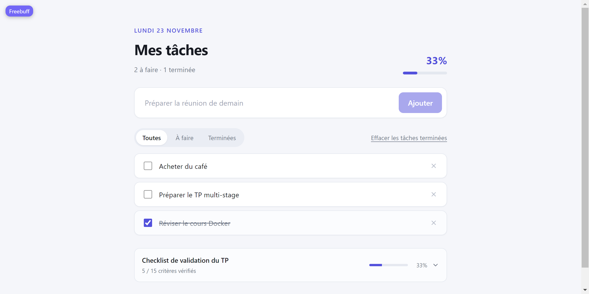
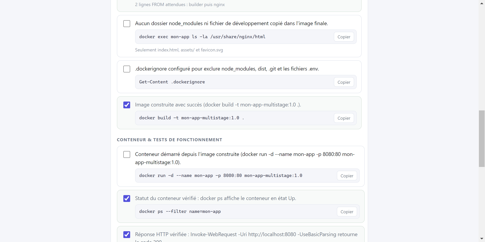

# Mes tâches — TP Docker multi-stage

Application web de gestion de tâches (React + Vite), compilée dans une image Docker
**multi-stage** où Nginx sert uniquement les fichiers statiques produits par la compilation.
L'application embarque aussi une section pliable « Checklist de validation du TP ».

Dépôt GitHub : <https://github.com/benoitvincent013-ship-it/TP-Docker-Multi-Stage>

---

## 1. L'application

« Mes tâches » est une application monopage qui permet de :

- ajouter une tâche (champ de saisie + bouton « Ajouter », ou touche Entrée) ;
- cocher une tâche comme terminée (texte barré, barre de progression et compteurs mis à jour) ;
- supprimer une tâche ;
- filtrer la liste : **Toutes / À faire / Terminées** ;
- effacer d'un coup toutes les tâches terminées ;
- conserver les tâches après fermeture du navigateur (`localStorage`) ;
- vérifier les critères du TP dans la section **« Checklist de validation du TP »**, repliée
  par défaut sous la liste : 15 critères répartis en 4 catégories, cases cochées sauvegardées
  dans le `localStorage` (clé `checklist-tp`), barre de progression dédiée et commande
  PowerShell copiable en un clic pour chaque critère.

L'application est entièrement statique : aucune API, aucune base de données.

## 2. Technologies

| Technologie | Version | Rôle |
|---|---|---|
| React | 18.3.1 | Interface (composants, état, hooks) |
| Vite | 5.4.21 | Compilation en fichiers statiques (`dist/`) |
| Node.js | 22 Alpine | Étape de compilation uniquement |
| Nginx | 1.27 Alpine | Étape finale : serveur de fichiers statiques |
| Docker | Docker Desktop | Construction et exécution de l'image |

Pourquoi React + Vite : c'est le choix le plus simple (deux dépendances, aucune configuration
de serveur, `npm run build` produit directement un dossier statique).

## 3. Prérequis

- Windows 11 avec **Docker Desktop** démarré.
- **PowerShell** (ou le terminal de VS Code).
- Internet pour le premier build (téléchargement des images `node` et `nginx`).
- _Facultatif_ : Node.js 22 pour lancer l'application hors Docker.

```powershell
docker --version
```

## 4. Structure du projet

```text
TP-Docker-Multi-Stage/
├── captures/                       # Preuves de fonctionnement
│   ├── 00-generation-package-lock.txt
│   ├── 01-build-image.txt
│   ├── 02-demarrage-conteneur.txt
│   ├── 03-test-http-headers.txt
│   ├── 04-test-http-body.html
│   ├── 05-verification-image-finale.txt
│   ├── 06-application-navigateur.png
│   ├── 07-verification-depot-github.txt
│   └── 08-checklist-validation.png
├── nginx/
│   └── default.conf                # Configuration du serveur (gzip, cache, fallback)
├── public/
│   └── favicon.svg
├── src/
│   ├── components/
│   │   ├── Checklist.jsx           # Section pliable de validation du TP
│   │   ├── TaskForm.jsx            # Formulaire d'ajout
│   │   ├── TaskItem.jsx            # Une tâche (case, libellé, suppression)
│   │   └── TaskList.jsx            # Liste + état vide
│   ├── data/
│   │   └── checklist.js            # Les 15 critères et leurs commandes
│   ├── App.jsx                     # État, filtres, progression, sauvegarde locale
│   ├── main.jsx                    # Point d'entrée React
│   └── styles.css
├── .dockerignore
├── .gitignore
├── Dockerfile
├── index.html
├── package.json
├── package-lock.json
└── vite.config.js
```

## 5. Le Dockerfile multi-stage

```dockerfile
# ÉTAPE 1 : compilation
FROM node:22-alpine AS builder
WORKDIR /app
COPY package.json package-lock.json ./
RUN npm ci
COPY . .
RUN npm run build          # génère /app/dist

# ÉTAPE 2 : production
FROM nginx:1.27-alpine AS runtime
COPY nginx/default.conf /etc/nginx/conf.d/default.conf
RUN rm -rf /usr/share/nginx/html/*
COPY --from=builder /app/dist /usr/share/nginx/html
EXPOSE 80
HEALTHCHECK CMD wget -q --spider http://127.0.0.1/ || exit 1
CMD ["nginx", "-g", "daemon off;"]
```

- L'étape 1 (`AS builder`) installe les dépendances et compile : elle contient Node,
  `node_modules` et les sources.
- L'étape 2 repart d'une image Nginx vierge et ne récupère que le dossier `dist/`
  grâce à `COPY --from=builder`. Elle ne contient donc ni Node, ni `npm`, ni
  `node_modules`, ni code source.
- Le `.dockerignore` exclut `node_modules`, `dist`, `.git`, `captures/` et les fichiers `.env`
  du contexte de build.

## 6. Construire l'image

```powershell
cd TP-Docker-Multi-Stage
docker build -t mon-app-multistage:1.0 .
```

## 7. Lancer le conteneur

```powershell
docker run -d --name mon-app -p 8080:80 mon-app-multistage:1.0
```

`-p 8080:80` publie le port 80 du conteneur sur le port 8080 de la machine.
Ces deux noms (`mon-app-multistage:1.0` et `mon-app`) sont ceux utilisés dans la
checklist de l'application : les commandes s'y copient telles quelles.

## 8. Accéder à l'application

**<http://localhost:8080>**

## 9. Tester

```powershell
# Le conteneur tourne et est "healthy"
docker ps

# Réponse HTTP du serveur
curl.exe -I http://localhost:8080

# Code de retour
(Invoke-WebRequest -Uri http://localhost:8080 -UseBasicParsing).StatusCode

# Fichiers statiques présents dans l'image finale
docker exec mon-app ls -la /usr/share/nginx/html

# Ni Node ni node_modules dans l'image finale
docker exec mon-app sh -c "command -v node || echo 'node absent'"
docker exec mon-app sh -c "find / -maxdepth 5 -type d -name node_modules"

# Taille de l'image
docker images mon-app-multistage:1.0
```

## 10. Arrêter et supprimer

```powershell
docker stop mon-app              # arrêter
docker start mon-app             # redémarrer
docker rm -f mon-app             # supprimer le conteneur
docker rmi mon-app-multistage:1.0 # supprimer l'image
```

## 11. Résultats des tests effectués

Tests réalisés le 23/11/2026 sur Windows 11 avec Docker Desktop.

| Test | Résultat |
|---|---|
| `npm ci` (étape de build) | 63 paquets installés |
| `npm run build` (Vite) | compilation sans erreur, dossier `dist/` généré |
| `docker build -t mon-app-multistage:1.0 .` | code de sortie `0`, image créée |
| Taille de l'image finale | **73,9 Mo** |
| `docker ps` | `mon-app` — `Up (healthy)`, `0.0.0.0:8080->80/tcp` |
| `curl.exe -I http://localhost:8080` | `HTTP/1.1 200 OK`, `Server: nginx/1.27.5`, `Content-Length: 677` |
| Temps de réponse | `0.0154 s` |
| Contenu de l'image finale | `index.html` (677 o), `assets/index-*.css` (6 108 o), `assets/index-*.js` (153 424 o), `favicon.svg` (249 o) |
| Absence de `node`, `npm`, `node_modules`, `/app` | confirmée |
| Fonctionnement des tâches | ajout, coche (progression 33 %), filtre « Terminées », persistance après rechargement |
| Checklist de validation | 5 / 15 critères cochés, barre à 33 %, sauvegarde `localStorage` `checklist-tp` conservée après rechargement, bouton « Copier » → retour « Copié ✓ » |
| Console navigateur | aucune erreur |

## 12. Captures

| Fichier | Contenu |
|---|---|
| `captures/01-build-image.txt` | Sortie réelle de `docker build` |
| `captures/02-demarrage-conteneur.txt` | Démarrage et état du conteneur |
| `captures/03-test-http-headers.txt` | En-têtes HTTP renvoyés par Nginx |
| `captures/04-test-http-body.html` | HTML servi par le conteneur |
| `captures/05-verification-image-finale.txt` | Fichiers statiques présents, absence de Node/`node_modules`, taille |
| `captures/06-application-navigateur.png` | L'application dans le navigateur (checklist repliée) |
| `captures/07-verification-depot-github.txt` | Vérification du dépôt public (codes HTTP) |
| `captures/08-checklist-validation.png` | Checklist dépliée avec critères cochés et commandes copiables |

### Application



### Checklist de validation



## 13. Développement hors Docker (facultatif)

```powershell
npm install
npm run dev   # http://localhost:5173
```

## 14. Versionnement

Le dépôt contient les sources, le `Dockerfile`, la configuration Nginx, le README et les
captures. Ne sont **pas** versionnés : `node_modules/`, `dist/`, `.env`, fichiers de l'éditeur.
Aucun secret n'est présent dans le projet.
